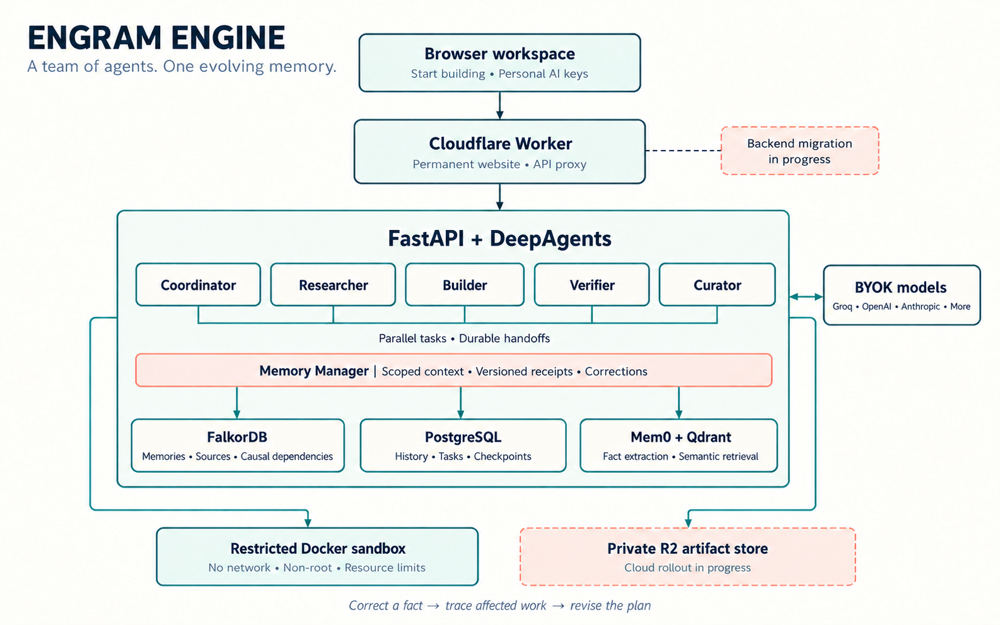
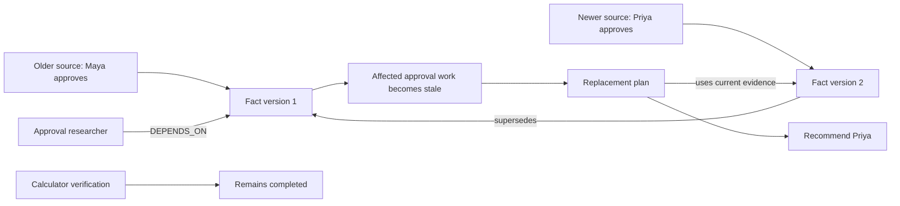
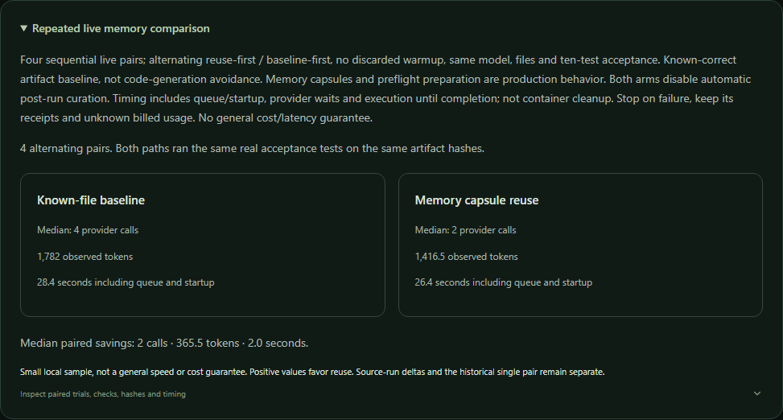

<div align="center">

# ENGRAM ENGINE

### A team of agents. One evolving memory.

**ENGRAM ENGINE is a team of AI agents that shares persistent graph memory, coordinates work, and traces how changing knowledge affects its decisions.**

[Open the website](https://engram-collective.spring-cherry-c778.workers.dev/) · [Beginner quickstart](https://engram-collective.spring-cherry-c778.workers.dev/quickstart) · [Inspect live evidence](https://engram-collective.spring-cherry-c778.workers.dev/evidence/live/) · [Submission story](docs/SUBMISSION.md)

**Graph Hacks: Context for AI Agents | Track 2: Agent Memory and Coordination**

</div>



## The release that remembers

A release is almost ready. One agent researches the approval policy, another prepares a capacity calculator, an independent verifier checks the files, and a curator saves what worked. The team restarts. Its conversations, checkpoints and verified procedure are still there.

Then a source changes: **Priya replaces Maya as the release approver.**

ENGRAM ENGINE follows the graph from that fact to the tasks that consumed it. Those tasks become stale, their old execution leases lose authority, and a replacement plan recommends Priya using the newer source. The calculator verifier stays completed because its work did not depend on the changed approval fact.

This is the central submission: **remember the evidence, coordinate the work, and change the action when knowledge changes.** The public evidence includes the completed model-driven workflow, actual process restart, memory correction, resulting plan, procedure reuse and the earlier failed attempts.

> **Hosting status:** The website, quickstart and published evidence are served from Cloudflare at the permanent address above. The live API, workers and databases currently run on the local machine through a protected tunnel. R2 is activated and private artifact storage has passed real integrity, authorization and source-snapshot checks. Full laptop-independent backend hosting is not complete. The latest local host storage failure has temporarily made Start building unavailable (HTTP 503); public home, quickstart, article and evidence pages remain online. Provider-backed work needs the visitor's own keys and available quota.

## Why this fits Track 2

| Track 2 requirement | What ENGRAM ENGINE implements |
| --- | --- |
| Episodic, semantic and procedural memory | Sourced observations and outcomes, Mem0-extracted facts with corrections, and versioned tool/workflow procedures bound to real artifacts |
| Persistent conversation history | PostgreSQL conversations and LangGraph checkpoints survive API and worker restarts |
| Shared state and handoffs | Durable scoped tasks, explicit evidence envelopes, acknowledged delivery and parallel specialist workers |
| High-concurrency reads and writes | Leased SQL scheduling, revision fences and real-store concurrency/recovery measurements |
| Separate user or tenant memory | A graph per tenant, project authorization, user/agent/team scopes and private-context inheritance |

FalkorDB is on the execution path. It supplies connected context and records the relationships that determine which work becomes stale after a correction. It is not a visualization added after the agent finishes.

## What makes the system distinctive

### Memory contracts instead of untracked recall

A task can bind to exact memory references and versions. The Memory Manager creates a compact context capsule, includes pinned obligations, and records a durable passport of the selected evidence and fingerprints. Required references cannot silently disappear to satisfy the context budget. Superseded action bindings and stale snapshots are rejected; historical inspection remains available.

The token budget uses `o200k_base` as a context-accounting unit. It is not a claim that every model bills those same token counts. Provider-reported usage is used in the live reuse evaluation.

### Handoffs with evidence and recovery

Agents delegate through ENGRAM ENGINE's durable scheduler. A receiver cannot run before its evidence envelope is committed. Delivery identity deduplicates repeated envelopes, and acknowledgement preserves its first timestamp. The scheduler uses PostgreSQL `FOR UPDATE SKIP LOCKED`, renewable leases and revision checks to coordinate workers. Waiting coordinators release a worker slot so specialists can proceed.

A handoff carries the relevant memory references and artifacts rather than hoping the receiving agent reconstructs the entire chat. Private evidence also makes the receiving task private before it can be claimed.

### Corrections that change the plan

FalkorDB connects facts, sources and task dependencies. A correction preserves the old fact as superseded, publishes the current fact, identifies its consumers and links the replacement plan to the new evidence. Revision fences prevent revoked workers from accepting stale completion results.



Selective impact is exact for explicit reference bindings. Broad unrestricted recall can create conservative dependencies. This is not a claim of perfect semantic impact analysis.

### Procedures that earn reuse

Procedures store preconditions, tool descriptors, artifact version manifests and verification evidence. A different verifier run executes the checks against the current file hashes before activation. Later agents discover relevant procedures semantically and reuse the checked artifacts instead of loading every possible tool or rebuilding known files.

A passing test is evidence of the tested behavior, not a proof that a procedure is universally correct. The verifier is a separate agent run, not independent human review.

## Architecture

| Component | Responsibility |
| --- | --- |
| React workspace | Projects, conversations, custom agents, workflows, graph timeline, procedures, artifacts and personal provider settings |
| FastAPI | Session and tenant authorization, scoped API, provider routing and artifact access |
| DeepAgents + LangGraph | Real model/tool loops, specialist execution and PostgreSQL-backed checkpoints |
| ENGRAM ENGINE scheduler | Parallel task claims, leases, budgets, handoffs, pause/resume, approvals and recovery |
| Memory Manager | Admission, retrieval, context capsules, write-back, corrections and procedural discovery |
| FalkorDB | Canonical connected memory, entities, provenance, supersession and task dependencies |
| PostgreSQL | Conversations, users, projects, tasks, events, leases, handoff state and checkpoints |
| Mem0 + Qdrant | Structured fact extraction, updates and derived semantic retrieval indexes |
| Local Mixedbread embeddings | Actual 1,024-dimensional vectors through llama.cpp CPU inference |
| Restricted Docker execution | Builder/verifier commands, artifact creation and real checks |
| Cloudflare | Permanent static website and protected API proxy; durable backend migration is ongoing |

The agent team includes a **coordinator, researcher, builder, verifier and curator**. Users can create custom specialists with narrower capabilities. Independent tasks run in parallel; dependent work waits for its inputs. Workflows add editable milestones, source and artifact dependencies, human approval gates, deadlines and bounded delegation.

### Three memory types, three retrieval tiers

Memory type describes what is remembered. Retrieval tier describes how it becomes context.

| Memory type | Example | Update behavior |
| --- | --- | --- |
| Episodic | A source observation, conversation turn, completed task or failed attempt | Retain the episode and its provenance |
| Semantic | The current approver for the ASTER release | Extract structured facts, preserve competing claims, consolidate and supersede supported corrections |
| Procedural | How to verify the capacity calculator with its exact artifact versions | Propose, independently check, activate, discover and reuse |

The retrieval tiers are **pinned context**, a **bounded revision-aware recent cache**, and **durable graph memory with retrieval indexes**. Lifecycle categories such as pinned, critical, episodic, relational, temporary and discard are separate from type and visibility.

Retrieval combines vector candidates, lexical scoring and connected entity expansion. The current implementation bounds candidate counts; it does not claim unlimited-scale retrieval. Claim resolution preserves competing evidence and uses source observation times. Equal-time contradictions remain unresolved, and a timestamp alone does not establish truth.

## What was actually verified

### Completed live team workflow

The additional **Groq `openai/gpt-oss-120b`** run completed with **five real agents**, actual parallel specialist scheduling, **two acknowledged handoffs**, **two sourced Mem0 write-backs** and **ten passing calculator pytest cases**. After an actual API/worker restart, its **24 checkpoint rows** and **two conversation messages** remained. A real admitted correction changed Maya to Priya, and the completed replacement plan used Priya while preserving the unrelated verifier's completed state.

Earlier quota, context-scope and context-budget failures are retained. This was a successful workflow with recovery, not a first-attempt success. The older Qwen-to-20B workflow is retained as separate historical evidence.

### Actual procedure reuse savings

**Four alternating matched pairs, eight successful Groq20B sessions.** Both arms used the same correct artifact bytes and ran the same ten real pytest cases. The baseline already knew the files; this measures verification reuse rather than avoiding all code generation.

| Median metric | Known-file baseline | Memory-capsule reuse |
| --- | ---: | ---: |
| Observed provider calls | 4 | 2 |
| Provider-reported tokens | 1,782 | 1,416.5 |
| Elapsed seconds, including queue/startup | 28.391 | 26.390 |

**50% fewer median calls and about 20.5% fewer median tokens.** Median paired elapsed-time savings were **2.001 seconds**. Three pairs favored reuse on time; one was slower. Four local pairs are not a general latency or cost guarantee. SDK-internal retries and unknown failed-call billing remain limitations. These 20B measurements must not be presented as results for the separate 120B team run.



### Concurrency, privacy and restart checks

A separate fixture exercised the real databases, graph and runtime without provider calls:

- **128 scoped reference reads** at concurrency 8: 70.72 operations/second, approximately 968 ms p95.
- **16 semantic writes** at concurrency 8: 20.97 seconds overall, approximately 14.61 seconds p95. CPU embedding work dominates write latency.
- **Eight corrections to the same revision:** one committed and seven received HTTP 409.
- **Selective invalidation:** one bound consumer became stale while fifteen unrelated consumers were preserved.
- **Twenty simultaneous duplicate handoff deliveries:** one receiver and one packet.
- A deliberately interrupted handoff recovered across a real process restart, preserving one acknowledgement; cross-tenant access was denied.

These are controlled infrastructure fixtures, not 128 model-driven agents or a production-scale benchmark.

### Regression record

| Check | Recorded result |
| --- | --- |
| Backend suite with real local infrastructure | **40 passed, 1 optional provider test skipped** |
| Local browser checks | **8 passed** |
| Public HTTPS browser check | **1 passed** |
| Frontend production build and Ruff | **Passed** |
| Separate live provider scenarios | Completed 120B workflow and eight matched 20B sessions |

The skipped provider pytest test is not counted as a pass. Provider-driven evidence comes from the separate actual live workflows. The source digest for the measured runtime is preserved, and later privacy/binding changes were tested separately. See [verification receipts](outputs/submission-live/track2/verification.json), [measurement methodology](docs/REUSE-MEASUREMENT.md), [verification scope](docs/VERIFICATION.md) and the [public evidence page](https://engram-collective.spring-cherry-c778.workers.dev/evidence/live/).

## Try ENGRAM ENGINE

1. Open the [beginner quickstart](https://engram-collective.spring-cherry-c778.workers.dev/quickstart), then choose **Start building**.
2. A private browser workspace is created. There is no sign-up form, but server-side session and tenant checks still apply.
3. Open **Profile & settings** and add your provider, exact model ID and personal API key. Saving a connection does not invoke the model. Testing it sends a small real request and may consume credit.
4. Add an optional personal LangSearch or Tavily key for live research.
5. Create a project, add source material, and submit a bounded objective. Watch the team tasks, artifacts, procedures and timeline.
6. Inspect the graph and memory evidence when a source changes. Use the current supported replan flow for affected work.

A useful first objective is: **Prepare a release approval brief from my sources, verify the supplied capacity calculator, and retain a reusable checked verification procedure.** Start with a small task before enabling broader workflows.

### Bring your own keys

Configurations support **Groq, xAI/Grok, Anthropic, Gemini, OpenAI, DeepSeek, OpenCode, OpenRouter, Mistral, Together and Fireworks**. Compatibility depends on the exact model's tool support and selected API protocol. Configuration support is not a claim that every model has passed the live team evaluation.

An optional separate personal admission connection can use **Groq Safeguard**. Mem0 is self-hosted and does not require a Mem0 Platform key. Users receive no operator inference key or silent substitute model. Missing keys, exhausted quotas and provider failures are surfaced explicitly.

Keys are encrypted server-side, scoped to the owning user and tenant, and excluded from prompts, sandbox environments and Git. The operator holds the encryption secret; this is not end-to-end encryption against the server operator. See [BYOK behavior](docs/BYOK.md).

## Run locally

The verified local launcher targets **Windows with WSL2 Ubuntu-22.04**, Docker Engine inside WSL, Node.js and `uv`. Use Python 3.11 for the application. `uv.lock` pins the application environment; the embedding runtime has its own pinned requirements.

```powershell
git clone https://github.com/ishaanv1709/ENGRAM-ENGINE.git
cd ENGRAM-ENGINE
Copy-Item .env.collective.example .env.collective
New-Item -ItemType Directory -Force data/models
```

Download the embedding model before the first start. The verified machine uses an existing FP32 Mixedbread GGUF; the model author's F16 GGUF is a documented fresh-checkout alternative:

```powershell
curl.exe --fail --location "https://huggingface.co/mixedbread-ai/mxbai-embed-large-v1/resolve/b33106f/gguf/mxbai-embed-large-v1-f16.gguf" --output data/models/mxbai-embed-large-v1-f16.gguf
```

Set `EMBEDDING_MODEL_PATH=data/models/mxbai-embed-large-v1-f16.gguf` in `.env.collective`, then start:

```powershell
.\scripts\start-local.ps1 -Install
```

Open **http://127.0.0.1:8088**, choose **Start building**, and configure personal connections in **Profile & settings**. Placeholder values such as `****` are deliberately unusable. You do not need every supported provider key.

```powershell
# Subsequent starts
.\scripts\start-local.ps1

# Stop application processes while preserving database volumes
.\scripts\stop-local.ps1
```

The installation downloads real dependencies and builds the sandbox image. The first launch can take time and requires disk space. [Detailed setup](docs/COLLECTIVE.md) covers WSL, model configuration, local ports and diagnostics. The entry flow described here and in [BYOK.md](docs/BYOK.md) supersedes older account-registration instructions in historical setup notes.

### Verify your installation

```powershell
# Real infrastructure checks
.\.venv-collective311\Scripts\python.exe scripts/test-local.py

# Credential-backed team workflow; consumes provider quota
.\scripts\verify-live.ps1

# Include real memory extraction and corrections
.\scripts\verify-live.ps1 -Memory

# Sandbox/reuse showcase without Groq inference
.\scripts\verify-advanced.ps1 -Stage showcase
```

The live harness pauses the normal worker while it schedules its test work and restores it afterward. Use an isolated development workspace for verification. Tests cannot establish live success when required services or provider quota are unavailable.

## Security boundaries

| Control | Enforced boundary | Important limit |
| --- | --- | --- |
| Sandbox | Non-root UID/GID 65534, no network, read-only image, dropped capabilities, no-new-privileges | Docker shares the host kernel; this is not a microVM |
| Resources | 1 CPU, 512 MiB memory, 128 processes, 120-second commands and bounded writable `/tmp` | Workspace disk is not quota-limited; output is size-checked after capture |
| Secrets and files | No provider environment, host source directory or Docker socket passed into the sandbox | Secrets deliberately supplied as task input or baked into an image remain exposed |
| Authorization | Tenant/project checks, scoped graph access and authorized artifact downloads | Trusted server, database and Docker administrators remain in the trust boundary |
| Model admission | Typed decisions, pending/quarantined input and explicit errors on failure | A model judgment does not prove truth or guarantee prompt-injection resistance |
| Task correctness | Leases, revision fences, artifact hashes and separate verification runs | Hashes identify bytes, not safety; tests only cover their assertions |
| External actions | Exact-argument approval and retained uncertain outcomes | No exactly-once guarantee for external side effects |

SQL and FalkorDB do not form one distributed atomic transaction. Recovery and reconciliation remain necessary. Cancellation cannot undo a command or provider call already in flight. Clearing browser site data loses automatic access to that browser workspace; cross-device recovery is not currently supplied by the no-sign-up flow.

Read the [complete security boundaries](docs/SECURITY-BOUNDARIES.md) before enabling external tools or exposing a deployment.

## Repository map

```text
collective/              API, graph memory, scheduler, agents and security controls
collective/tests/        Backend and real-service verification
frontend/                React workspace and Playwright browser checks
infra/cloudflare/        Permanent website Worker and deployment configuration
infra/linux/             Linux deployment preparation
scripts/                 Install, run, verify, measure and publish evidence
docs/architecture/       Generated architecture visual and its generation brief
docs/blog/               Illustrated project article and its assets
outputs/submission-live/ Sanitized published evidence and verification receipts
```

Runtime databases, private session files, model weights, secrets, dependency caches and personal artifacts are intentionally excluded from the repository.

## Read more

- [Focused submission: The Release That Remembers](docs/SUBMISSION.md)
- [Complex workflows and custom agents](docs/WORKFLOWS.md)
- [Provider behavior and personal keys](docs/BYOK.md)
- [Causal demo protocol](docs/LIVE-DEMO.md)
- [Reuse evaluation methodology](docs/REUSE-MEASUREMENT.md)
- [Infrastructure and browser verification](docs/VERIFICATION.md)
- [Security controls and their limits](docs/SECURITY-BOUNDARIES.md)
- [Current Cloudflare hosting boundary](docs/CLOUDFLARE-HOSTING.md)
- [Illustrated blog post](docs/blog/README.md)

## Current limits and next steps

Complete durable backend hosting, migrate local state safely, and repeat restart/privacy/sandbox checks in the cloud. Expand evaluation beyond four local reuse pairs and document independent reproductions. Improve source-trust policies and assess the remaining long-argument fidelity issue observed with Qwen. Triton acceleration is deferred.

ENGRAM ENGINE uses FalkorDB, LangChain DeepAgents, LangGraph, Mem0, Qdrant and other open-source components under their respective licenses. Third-party font notices are retained with the blog assets. The architecture illustration is explanatory; the implementation, receipts and declared hosting status determine what is currently working.
