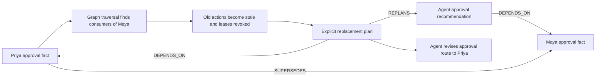

# Live submission evidence

<!-- track2-upgrade:start -->
## Track 2 upgrade: memory contracts and replay-safe coordination

ENGRAM now binds work to explicit memory references, loads compact context capsules and records durable memory passports with revisions, content hashes, projection fingerprints and budget accounting. Pinned obligations remain included. A reference superseded before startup is rejected; a correction racing with snapshot subscription also fails closed. Replacement plans bind the new active fact rather than treating historical quoted IDs as current instructions. Explicit full historical reads remain possible.

Handoffs use deterministic delivery identities and an unclaimable `awaiting_handoff` state. The envelope and queued transition commit together. Identical retries reuse one receiver; current evidence revisions are checked before acknowledgement, and replay preserves the first acknowledgement. Private references and parents mark tasks private before enqueue. Private-memory correction events are filtered from another member's timeline, including legacy untagged events.

### Four new live matched pairs

All eight verifier sessions passed the same ten real pytest cases with Groq `openai/gpt-oss-20b`, identical artifact hashes, alternating order and no discarded warmup. Both paths disabled automatic post-run curation. The baseline already had known correct files; this measures verification reuse, not avoided code generation.

| Median metric | Known-file baseline | Memory-capsule reuse |
| --- | ---: | ---: |
| Observed provider calls | 4 | 2 |
| Provider-reported tokens | 1,782.0 | 1,416.5 |
| Elapsed seconds including queue/startup | 28.391 | 26.390 |

Median paired savings: **2 calls**, **365.5 observed tokens** and **2.001 seconds**. That is 50% fewer median calls and about 20.5% fewer median tokens. Three timing pairs favored reuse; one was slower. Four local pairs cannot establish a general cost or latency guarantee. SDK-internal retries are not separately counted; failed calls can have unknown billed tokens.

The exact measured runtime source is preserved under ignored `data/collective/track2-upgrade/measured-runtime/` with digest `d87aba1fc7b1c3f06bd2d3ffd31f3a2a654096c214c187d75939854aa51d3db8`. Final private-reference, stale-binding, audit-event and coordinator context/scope recovery changes were tested separately; those changes are not retroactively relabeled as the source of the four-pair measurements.

### Real concurrency and crash recovery

- 128 direct-reference context reads at concurrency 8: **70.7 operations/s**, p95 **968.1 ms**, zero operation errors. This includes scoped retrieval and durable provenance, not semantic-search embeddings or LLM throughput.
- 16 semantic writes at concurrency 8: **20.968 seconds** total, p95 **14605.0 ms**, zero errors. Local CPU embeddings dominate this path; it is not a FalkorDB performance claim.
- Eight competing corrections: one committed replacement, seven stale-revision conflicts. Exactly **one of sixteen** bound consumers was invalidated; fifteen unrelated consumers were preserved at correction time.
- Twenty concurrent identical handoffs: one receiver and one envelope. A deliberately interrupted delivery survived actual API/worker restarts, recovered into the same receiver, and retained one acknowledgement after replay.

These load/recovery fixtures call real production functions and services with **zero provider calls**. They are not described as autonomous model completions. The earlier recovered end-to-end team scenario remains separately documented below.

### Final checks and remaining live blocker

Final real-service regression: **40 passed, 1 opt-in provider test skipped**. Provider inference was disabled for that suite. The live pairs above use actual provider inference separately. **8 local browser checks** and **1 public HTTPS checks** passed. Production build and Ruff passed.

The additional Groq120B team workflow completed across an actual API/worker restart: checked procedure reuse, researcher-to-curator handoff, real Mem0 write-back and correction, and a replacement plan recommending Priya. The calculator verifier remained completed while the graph invalidated consumers of the changed approval fact. Earlier 20B quota and 120B scope/budget attempts remain recorded; this is not a first-attempt success. Four-pair savings remain Groq20B measurements. The original Qwen long-argument fidelity failure remains unresolved. Permanent hosting and publishing the matching source repository remain pending; the public tunnel depends on its laptop.

Inspect `/evidence/live/` on the running app. `track2-upgrade.json` contains sanitized receipts and every paired observation. The Procedures page exposes Memory passports, Durable handoff receipts and the repeated live comparison without adding navigation destinations.
<!-- track2-upgrade:end -->

This run uses the real local API, encrypted personal provider connections, DeepAgents worker, FalkorDB, PostgreSQL, Qdrant, Mem0 and Docker sandboxes. It creates a separate ORCHID workspace. No model response or execution receipt is substituted.

## Run and inspect

Use the installed `.venv-collective311/Scripts/python.exe` to run `scripts/submission-live-demo.py` from the repository root. Runtime reports and the private browser session are saved under ignored `data/collective/submission-live-2026-10-18/`. Never publish `session.json` or credential storage.

The `start` phase explicitly saves the previously authorized local Groq and LangSearch keys only into this demo owner's encrypted profile. Other visitors still receive no host credentials. `submit` resumes setup after an initial failure without creating another workspace. The default model is the exact locally configured Qwen model; the dedicated admission connection is Safeguard.

On 18 October, Qwen's daily token quota was exhausted after real source generation, independent checks and sourced curation. The user explicitly authorized Groq `openai/gpt-oss-20b` for completion. `use-20b` records this model transition and performs a real tool-readiness probe before any task is resumed. Both measured comparison arms use the completion model. This is an authorized configuration change, not an automatic provider fallback. Initial Qwen attempts remain in the evidence.

| Phase | Required observation |
| --- | --- |
| `start`, then `status` | Live ingestion, coordinator dispatch, specialist runs, real artifacts and independent checks |
| `causal-before` | An agent reads the resolved Maya fact and recommends the approval route |
| `correct` | Preserve Maya and Priya claims, resolve the newer observation, follow actual dependency edges and mark the old action stale |
| Actual `scripts/restart-app.ps1` | API and worker process IDs change; durable state remains in the same services |
| `after-restart` | Same private session, active Priya fact, explicit replacement plan created from the saved correction |
| `benchmark-baseline` | A live verifier receives the known exact artifact bundle and runs the tests |
| `benchmark-reuse` | Another live verifier uses the active procedure and the same artifact versions |
| `evidence` | Both checks pass, validated reuse receipt exists, replacement action names Priya, conversation persists, handoffs are acknowledged |

Each phase checks its prerequisites and stops on failure. The final report gains `passed: true` only after the evidence assertions succeed. A process restart alone does not establish a completed autonomous workflow.

## Graph necessity

Claim resolution uses the latest active source observation. The demo author supplies the two source observations; this is not a claim that agents autonomously discovered the correction or verified the source's authority. The important live test is that an agent consumed the old fact and changes its recommendation using the persisted replacement graph.

## Measurement boundaries

The live comparison gives both verifier sessions the same artifact versions and acceptance command. The baseline already knows correct code. It measures execution and context overhead, not code-generation avoidance. Positive signed baseline-minus-reuse deltas mean savings; negative values mean extra overhead. One pair cannot establish a dependable speed or cost improvement.

`model.provider_receipt` events capture Groq-adapter calls from the agent loop, Safeguard and Mem0 under each run. Successful receipts retain provider-reported token usage. Failed calls retain the exception type and unknown token usage. SDK-internal retry attempts are not individually counted. Embeddings run locally and are not provider inference tokens. Existing `model.usage` events measure only the agent loop and are shown separately to avoid double counting.

No estimated avoided calls, theoretical token savings or zero cost for failed requests are substituted for measurements. The earlier five-pair provider-free benchmark remains separate in [REUSE-MEASUREMENT.md](REUSE-MEASUREMENT.md).

## Reliability and security

The initial long repetitive tool-argument probe still failed exact fidelity: 800 expected characters, 496 received. Source generation is deliberately bounded, and artifact checks are required. This does not establish reliability for arbitrarily large generated files.

Safeguard can return malformed structured output. The adapter retries recognized parsing failures once on the same model and validates the result; it never supplies an accept-on-error decision. Admission remains a model judgment. Session authorization, tenant boundaries, task leases and sandbox restrictions remain enforced in code. See [SECURITY-BOUNDARIES.md](SECURITY-BOUNDARIES.md).

## Recorded completed result

| Measured metric | Exact artifact bundle | Verified procedure | Baseline minus reuse |
| --- | ---: | ---: | ---: |
| Observed provider calls | 4 | 3 | +1 |
| Observed provider tokens | 1,823 | 5,034 | -3,211 |
| Elapsed seconds, including queue/startup | 66.407 | 53.918 | +12.489 |

Both arms used Groq `openai/gpt-oss-20b`, the same two artifact versions and the same ten-test pytest suite in fresh restricted containers. The baseline received known correct files; reuse loaded the active, independently verified version 1 procedure. Both used automatic owner-authorized memory scope and disabled automatic post-run curation. Counts include recorded Groq-adapter agent, memory and admission requests attributed to each verifier. Positive signed differences favor reuse; negative values mean overhead. This is one baseline-first pair with warm shared services, not a randomized performance study or a code-generation savings estimate. Failed calls can have unknown billed tokens; SDK-internal retries are not counted individually.

This was a recovered, multi-attempt execution, not a first-attempt or all-Qwen pass. The evidence retains 8 excluded debug comparison pilots and the stopped first replan; only the final matched pair enters the table. The correction was supplied explicitly, not autonomously discovered. Conservative context dependencies invalidated all eight historical fixture runs, so minimal semantic impact analysis is not demonstrated. The earlier exact 800-character Qwen tool-argument probe still failed (496 received); its cause is unresolved. The public Cloudflare demo remains laptop-dependent; permanent hosting is pending. The existing film predates this validation.
