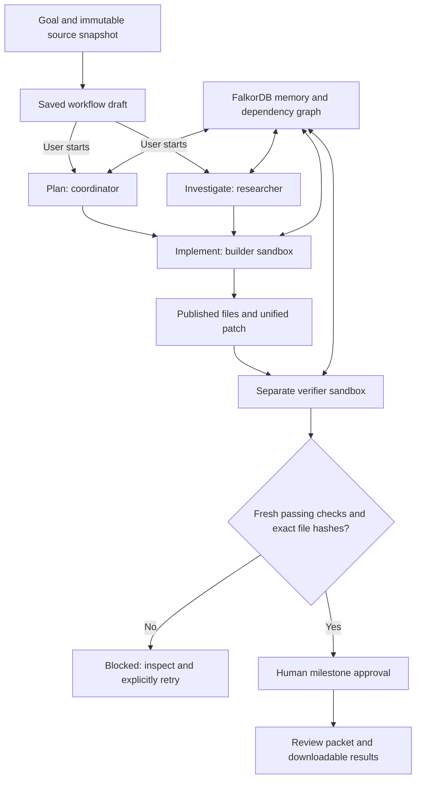

# Complex workflows in ENGRAM ENGINE

ENGRAM keeps its DeepAgents team and graph memory. The workflow layer adds a durable plan around that team: independent investigations can run in parallel, implementation waits for their results, a separate verifier checks the published bytes, and a human can gate the next milestone.

## Use the local website

1. Open **Workflows**, enter a concrete goal and optionally import a source ZIP.
2. Review the five suggested milestones: plan and investigate in parallel, implement, check independently, prepare the review packet. Edit instructions, dependencies, role, acceptance and approval requirements before saving.
3. Optionally create a named specialist under **Inspect & manage → Custom agents**. Select it in a milestone with the same base role. Instructions and capability restrictions are copied into the saved plan.
4. Set execution budgets, then **Save workflow draft**. Saving does not invoke a model. **Start workflow** explicitly enables execution with the configured provider.
5. Follow milestone progress, download published outputs and inspect check receipts. Pause fences existing task leases; resume reclaims the task with a new revision. Cancel stops scheduling. Failed or stale work requires an explicit retry; approval is cleared for the new generation.

This interface retains the existing Workspace, memory, graph, procedures, claims and sandbox views.

## What execution enforces

PostgreSQL stores the workflow, dependency DAG, step generations, leases, approval records, event signals and attempt reservations. FalkorDB continues to hold connected memory and task dependencies: correcting evidence can invalidate a task and block its milestone. The scheduler does not perform inference. It creates deterministic task and handoff identities, allowing a later tick to recover scheduling after a process restart without inserting duplicate root tasks.

Coordinators may delegate to nested coordinators inside a budgeted workflow. Child tasks inherit the workflow and milestone, consume its task/depth/attempt budgets and retain the parent's shared-memory restriction. The milestone waits for all tasks in its current generation. `parent_key` groups milestones in the API; dependency edges, not grouping, determine execution order.

The default limits are three parallel tasks, 64 total tasks, delegation depth six, 100 agent inference attempts and 600 tool attempts. Global worker slots can lower effective parallelism. Claim allocation uses a short PostgreSQL advisory lock to prevent two workers taking the final slot; execution itself remains parallel. No new throughput benchmark is claimed.

Reservations happen before logical model/tool execution and are retained across pauses and budget changes. These are **not spending or token caps**: policy judgments, extraction calls and SDK transport retries have separate costs. A workflow has a deadline, defaulting to 24 hours from draft creation; the API supports one minute to seven days. Expired workflows reject claims, heartbeats and completion, and the scheduler fences their active tasks.

Profiles narrow the existing base role's capability set. Their allowlist currently selects built-in tools; remote MCP capabilities are not selectable in a custom profile. Profiles and workflow control are scoped to the creating user within the tenant. Source snapshots are shared within the project. Existing memory supports team, user and agent visibility; workflows default to shared-only context.

## Real source and artifact handling

ZIP import records an immutable manifest with file hashes and publishes the actual text files. It rejects traversal paths, links, duplicates and unsupported archives. Limits: 8 MB upload, 500 archive entries, 200 retained UTF-8 text files, 1 MB per file and 20 MB expanded text. Environment files and common generated directories are excluded; this is not comprehensive secret scanning. Code is never extracted or executed on the host.

Builders and verifiers receive source files in their own restricted Docker volumes. Completed predecessor artifacts override the initial snapshot. Nested paths are preserved. Python writes invalidate sibling bytecode caches so same-size, rapid edits cannot accidentally test stale code. The container disables automatic bytecode generation as well.

`repository_patch` compares selected published files against the snapshot and publishes a real unified diff, including missing-final-newline markers. It supports textual additions and modifications; deletions, renames, binary changes and applying a patch to a remote branch are not implemented. It does not push code.

An independent acceptance gate requires a separate verifier run's fresh recognized passing checks and a host-recorded comparison of its current sandbox bytes with all incoming artifact hashes. Tests can still be incomplete or misleading; a passing gate does not prove arbitrary code correct. Ambiguous same-path predecessor outputs block verification for explicit resolution.

## External actions and approvals

Existing configured public HTTPS MCP servers can expose external capabilities. For workflow tasks, an attempted remote invocation records the exact server URL, tool and canonical arguments, pauses the workflow and requests human approval. The UI can execute those exact arguments or reject them. Execution rechecks the current tenant connection and tool allowlist and retains the actual result receipt.

A completed action's receipt is reused if the agent requests the same run/tool/arguments again. If execution fails after approval, its status becomes `unknown`; a process crash can leave `executing`. Neither state is automatically repeated. Inspect the remote system before reconciling it. This prevents blind retries; it is **not distributed exactly-once execution**, and there is no automatic reconciliation UI.

No GitHub, CI or deployment service is configured by this feature. A real authorized MCP connection and the service's credentials are required for those operations. Local source repair and review artifacts do not require such credentials. See [security boundaries](SECURITY-BOUNDARIES.md) for the actual container, network and admission limits.

## Verification without provider calls

Run `.\scripts\verify-advanced.ps1 -Stage all-checks`. It pauses the managed worker while production infrastructure and tools are exercised directly, then restores a previously running worker. `workflow-checks` selects the workflow tests alone. These tests do not substitute model outputs or remote action receipts, and do not establish autonomous planning quality.

The workflow integration scenario imports a real nested source tree, observes failing tests, repairs and publishes files, checks the patch with `git apply --check`, transfers artifacts to another container, runs fresh tests and rejects bytes changed after verification. Other checks cover claim concurrency, task/depth/attempt limits, expired completion, tenant scope, approval/event gates and proposal rejection without executing any remote effect.

Browser checks create an actual custom specialist, upload a ZIP and save a draft without starting model work. A separate check compares that workflow's persisted state after an actual API/worker restart. Live autonomous DeepAgents execution, Mem0/Safeguard inference and remote MCP effects require their own credential-backed checks. The previously reported Qwen quota and tool-argument fidelity blockers remain unresolved until those checks pass.
