# Building Persistent Agent Teams with ENGRAM ENGINE

*Engineering notes · Updated 18 October 2026 · Built for Graph Hacks Track 2*

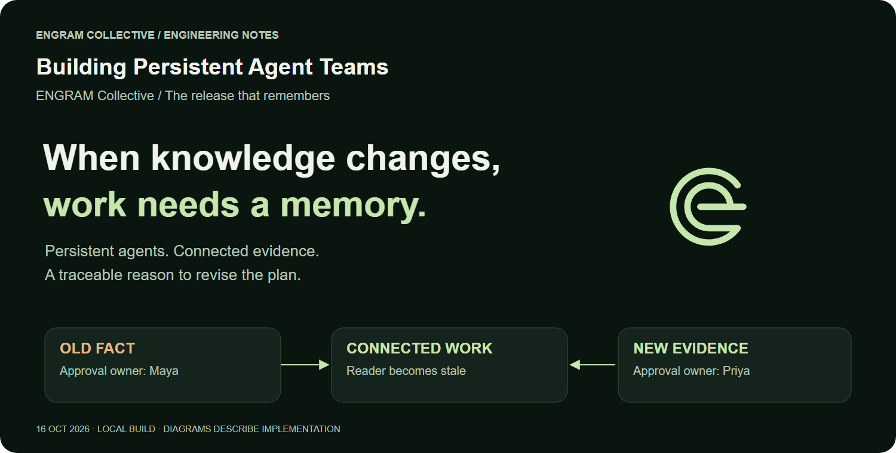

A release plan can be correct when an agent writes it and wrong an hour later. The approval owner changes. A requirement is revised. A teammate discovers that the source everyone trusted is out of date.

Saving the conversation helps an agent remember what it was told. A team also needs to know **which work relied on that information**, whether the work is still valid, and how to revise it without erasing its history.

ENGRAM ENGINE is a persistent team of AI agents with shared graph memory. LangChain DeepAgents supplies the agent harness; FalkorDB holds connected memory and the relationships that drive context retrieval and invalidation. PostgreSQL coordinates durable tasks and history. Restricted Docker containers execute and check artifacts.

The central engineering question is simple: **when a fact changes, which work must change with it?**

The local build now has a completed live team scenario across a real restart, with recovery and an explicitly authorized Qwen-to-20B model change. It also has inspectable graph evidence and matched model-backed reuse measurements. Earlier infrastructure experiments below remain labeled separately.

## A release workflow makes memory concrete

Consider a release called ORCHID. A researcher finds official documentation, a builder creates a capacity-checking artifact, a verifier runs independent checks, and a curator turns the successful outcome into a reusable procedure. A coordinator delegates the work and retains its progress.

Then a newer source names Priya as approver where an earlier source named Maya.

The completed live workflow preserves both claims, selects the current observation under an explicit policy, identifies tasks that consumed the old fact, and creates a revised plan. A replacement plan completed after a real restart, and a separate session reused the exact independently verified procedure version.

The earlier 16 October infrastructure fixture left its replacement plan blocked. The separate 18 October model-backed scenario completed its repaired replacement plan. These fixtures retain separate IDs and reports; the older blocked fixture has not been relabeled as a success.

## The team shares evidence and keeps its execution separate

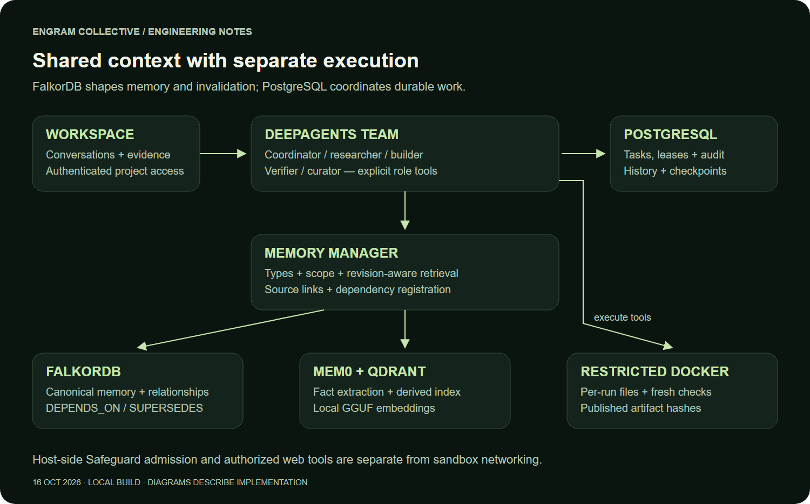

Collective uses five specialist roles. The coordinator decomposes work; researchers collect evidence; builders produce artifacts; verifiers execute checks; curators consolidate outcomes. Their roles describe responsibilities and tool permissions. Actual completion depends on persisted results and check receipts.

A handoff carries evidence IDs, artifact IDs, a checkpoint and the remaining work. Published files carry SHA-256 hashes, allowing the receiving agent to check that it obtained the intended bytes. Builder and verifier execution happens in separate run containers and volumes.

PostgreSQL stores conversations, task status, checkpoints, audit events and leases. Workers claim eligible tasks with `FOR UPDATE SKIP LOCKED`; lease tokens and revisions prevent an old worker from committing after ownership changes. Dependency-aware scheduling allows independent tasks to proceed while ordered work waits.

This implements concurrent coordination mechanisms. It does not establish a production throughput figure: a large concurrent load benchmark remains future work.

We use the [DeepAgents harness](https://docs.langchain.com/oss/python/deepagents/overview), but keep ENGRAM's task scheduling, resource preparation and authorization explicit. The system's shared state is persisted outside an individual model conversation.

## Three memory types and three retrieval tiers solve different problems


| Memory type | What ENGRAM retains | Why the team needs it |
| --- | --- | --- |
| Episodic | Observations, task objectives, conversations and outcomes | Recover what happened and where a conclusion came from |
| Semantic | Extracted facts and source-linked corrections | Retrieve current knowledge without replaying every episode |
| Procedural | Tool descriptions and artifact-bound workflows | Find relevant capabilities and repeat verified work |

These types describe the meaning of memory. The retrieval tiers describe how context reaches a run: pinned context, a revision-aware recent cache, and persistent graph retrieval. A semantic fact can be pinned or retrieved; it is not itself a storage tier.

The normal observation path stores a pending episode, requests a typed admission decision, and quarantines suspicious input or archives noise. Admitted observations proceed to [Mem0](https://docs.mem0.ai/introduction) extraction, with source links retained as facts and relationships enter the memory graph. Qdrant supports the derived vector index; local GGUF embeddings support retrieval.

Task instructions remain episodes. A goal such as “find the approval owner” should not become an established world fact merely because an agent was asked to investigate it.

Tools also live in procedural memory. The runtime retrieves relevant optional capabilities and combines them with the permitted core tool set. This provides a concrete mechanism for avoiding an ever-growing prompt containing every tool definition. We have not yet measured its performance with hundreds of tools.

## FalkorDB determines which work becomes stale

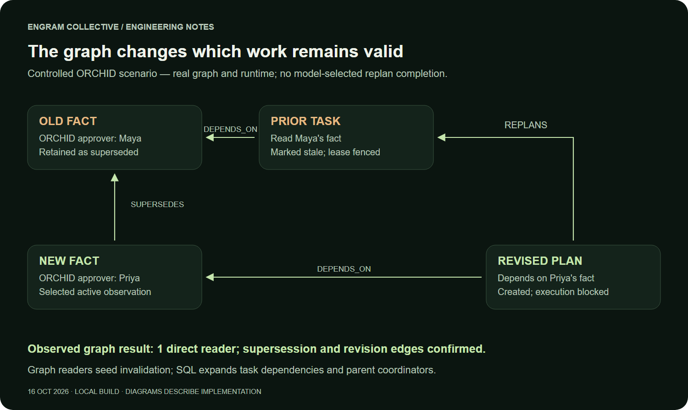

When a task reads memory, the runtime records the relationship:

```cypher
MATCH (t:Task)-[:DEPENDS_ON]->(m:Memory {id: $old})
RETURN DISTINCT t.id
```

This is the essential invalidation pattern. The production witness query also restricts results to the authorized project, memory IDs and accessible task IDs.

A correction adds `new Memory → SUPERSEDES → old Memory`. FalkorDB finds the direct readers of the old version. PostgreSQL then expands affected parents and downstream task dependencies, marks impacted work stale and increments execution revisions. A late result carrying the old lease cannot be accepted.

Replanning is an explicit action. It creates `new Task → REPLANS → old Task` and binds the new task to the corrected memory through `DEPENDS_ON`. Old objectives remain historical evidence; the new coordinator is instructed to derive current work from the corrected context.

This is where the graph changes execution. A similarity search may find a document mentioning the release, but it does not identify the historical task that consumed a specific superseded memory version. Without a recorded dependency edge, this traversal cannot identify that reader. Dependency tracking therefore has to happen during execution, not be reconstructed only for a presentation afterward.

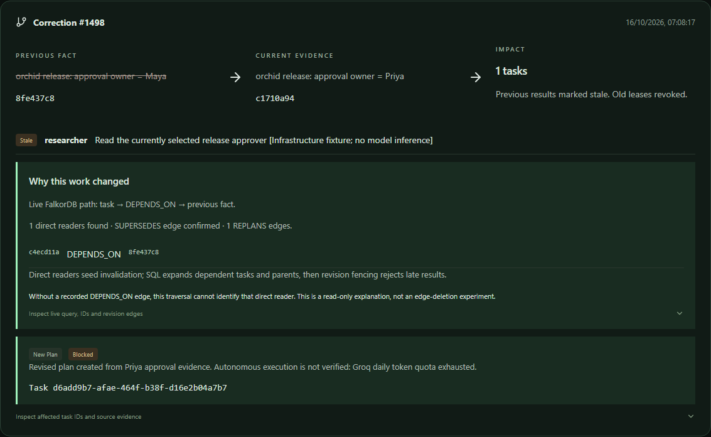

The causal view exposes the live query, direct reader IDs, supersession and revision edges. A regression checks that an unrelated task stays queued rather than invalidating the whole project. Another check ensures hidden task IDs do not appear in the explanatory traversal.

## Competing claims keep their sources

The ORCHID scenario uses controlled sample observations with recorded timestamps. Maya's claim remains visible after Priya's is selected. Each immutable claim retains a source, observation time and claimant identity.

Resolution is serialized per tenant, project, subject and predicate. The current policy selects the latest active source observation. Contradictory values at the same observation time remain unresolved, and the previous selected fact becomes disputed. Claimants cannot supply a different timestamp from the one recorded on their source.

This is an explicit conflict policy, not a truth oracle. A newer source can still be wrong. Timestamps do not authenticate a document or grant someone approval authority. The benefit is that disagreement remains inspectable and the rule for choosing a current value is visible.

## A procedure binds instructions to the files that passed

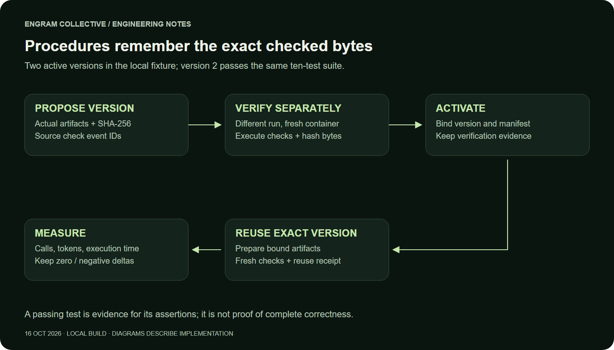

A useful procedure needs more than a remembered sentence saying that a workflow succeeded.

ENGRAM binds each procedure version to actual artifact IDs and hashes, source check events, declared conditions and the configured sandbox image. Activation requires a different verifier run to execute fresh recognized passing checks and demonstrate that its current file bytes match the manifest. The proposer cannot activate its own version.

Reuse prepares that exact manifest in a new run, executes fresh checks and retains a separate receipt. A later file with the same name cannot silently replace the bound artifact. The controlled example has two versions of a capacity function; version 2 adds reserved headroom and input validation and passes a ten-test suite.

The safeguards have limits. A different run is not independent human judgment, and passing tests do not prove complete correctness. Declared natural-language preconditions remain a verifier responsibility. The configured image tag is checked, but production execution is not pinned to an immutable image digest.

## Measuring reuse without manufacturing a saving

We ran five paired local experiments without model inference. The baseline received a known exact version 2 artifact bundle. The reuse arm loaded the active artifact-bound procedure. Both copied identical bytes into fresh containers and ran the same ten-test suite.

Order alternated between pairs. Timing used a monotonic clock from resource preparation through execution and hash or receipt validation. It included container startup and mandatory reuse checks, and excluded task creation, task completion and container cleanup.

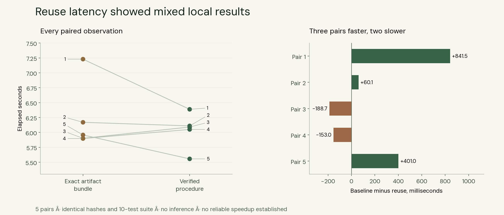

| Measurement | Exact artifact bundle | Verified procedure |
| --- | ---: | ---: |
| Trials | 5 | 5 |
| Median elapsed time | 5.957 s | 6.090 s |
| Observed range | 5.897–7.229 s | 5.556–6.388 s |
| Tool calls per trial | 3 | 3 |
| Pytest executions per trial | 1 | 1 |
| Agent-model calls per trial | 0 | 0 |
| Agent-model tokens per trial | 0 | 0 |
| Passing tests per trial | 10 | 10 |

All ten trials passed the same ten-test suite; these are repeated executions, not one hundred distinct tests. Three pairs favored reuse and two favored the bundle. The median paired baseline-minus-reuse difference was **60.1 ms**, even though the separate reuse median was slower. Those are different summaries of the five observations, not contradictory measurements.

The differences are small and mixed. **This experiment does not demonstrate a reliable latency improvement, tool-call saving or model-token saving.** It measures execution overhead against a baseline that already has correct code. It cannot establish savings from avoiding research, code generation or debugging.

That result is useful. The verified-procedure path performs version and receipt checks while completing in roughly the same local time range. Its demonstrated benefit is traceable reuse of specific checked bytes. The new live pair below adds matched objectives, equal tests and actual provider receipts; repeated trials are still needed.

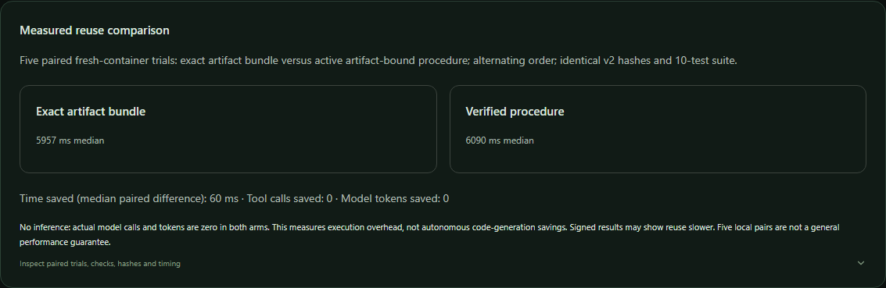

## Persistence checks and current verification

The API and agent processes were restarted, and two separate fixtures were checked afterward.

| Retained state | Partial live Qwen fixture | Controlled infrastructure fixture |
| --- | ---: | ---: |
| Authenticated session | Survived | Survived |
| Memories | 23 | 9 |
| Published artifacts with retained hashes | 0 | 4 |
| Checkpoint threads | 3 | 0 |
| Procedure versions checked by this restart report | Not evaluated | 2 |
| Concurrent claims checked by this restart report | Not evaluated | 2 |
| Revised plan status | Not evaluated | Blocked |

These 16 October results establish persistence across separate fixtures. The 18 October scenario below adds one completed story across a restart.

| Evaluation | Observed result | Scope |
| --- | --- | --- |
| Local regression suite | 25 passed, 1 skipped | The skipped case requires live provider credentials |
| Later targeted regressions | 3 passed in 41.73 s | Graph isolation and witnesses, procedure guards and budget ordering; overlaps earlier coverage |
| Expanded browser flow | 1 passed in 3.5 s | Real UI and API, hashes, benchmark display, security copy and cross-tenant denials |
| Paired procedure experiment | 10 of 10 trials passed | Same ten-test suite in fresh containers; no inference |
| Bounded container probes | Passed | Inspected configuration, filesystem and network behavior, path denials |
| Full autonomous Qwen workflow | Unverified | Daily token quota and a separate tool-argument fidelity failure remain unresolved |

These older partial runs remain historical evidence. The separate 18 October result below records the completed recovered workflow.

## Security depends on enforced boundaries

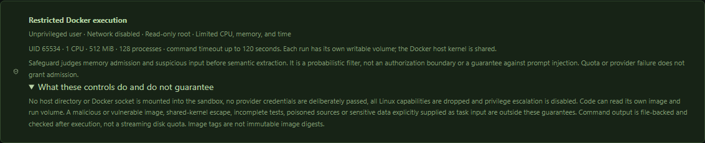

The sandbox runs as UID/GID 65534 with all capabilities dropped, privilege escalation disabled, a read-only root filesystem and no network. Each run receives its own writable volume. The launch configuration sets one CPU, 512 MiB of memory, 128 processes and command timeouts up to 120 seconds. It mounts no host directory or Docker socket and deliberately passes no provider credentials.

Actual probes confirmed the configured restrictions, a denied root write, a successful run-volume write, an absent Docker socket and a failed external connection attempt. Workspace path checks returned explicit denials for traversal and outside paths.

The Docker host kernel is shared. The run volume has no disk quota here, and captured output is size-checked after execution rather than while it grows. Image-baked secrets and sensitive input deliberately supplied to a task would remain visible inside the container. These probes are not evidence of resistance to kernel escapes.

Safeguard admission is a separate probabilistic filter. It helps identify suspicious input before semantic extraction, but it does not grant authorization and does not guarantee protection from prompt injection. Authorization, role checks, memory visibility and task leases are enforced by code. A failed policy request does not promote its pending episode to active. Controlled internal memory commits used for infrastructure fixtures intentionally bypass this admission path.

## Completed live scenario: 18 October 2026

The real DeepAgents coordinator dispatched researcher and builder work, published two files, acknowledged a handoff, completed independent checks and retained an artifact-bound procedure. The initial model was Qwen; after its daily token quota was exhausted, the user explicitly authorized Groq 20B to finish. An agent first recommended routing ORCHID approval to Maya. A supplied newer source named Priya. FalkorDB dependencies identified old readers and fenced stale work. After an actual API and worker restart, the repaired replacement plan completed and recommended Priya without repeating documentation research or rebuilding code. The same private session, two conversation messages, both artifact hashes and 40 original coordinator checkpoint rows survived.

| Measured metric | Exact artifact bundle | Verified procedure | Baseline minus reuse |
| --- | ---: | ---: | ---: |
| Observed provider calls | 4 | 3 | +1 |
| Observed provider tokens | 1,823 | 5,034 | -3,211 |
| Elapsed seconds, including queue/startup | 66.407 | 53.918 | +12.489 |

Both arms used Groq `openai/gpt-oss-20b`, the same two artifact versions and the same ten-test pytest suite in fresh restricted containers. The baseline received known correct files; reuse loaded the active, independently verified version 1 procedure. Both used automatic owner-authorized memory scope and disabled automatic post-run curation. Counts include recorded Groq-adapter agent, memory and admission requests attributed to each verifier. Positive signed differences favor reuse; negative values mean overhead. This is one baseline-first pair with warm shared services, not a randomized performance study or a code-generation savings estimate. Failed calls can have unknown billed tokens; SDK-internal retries are not counted individually.

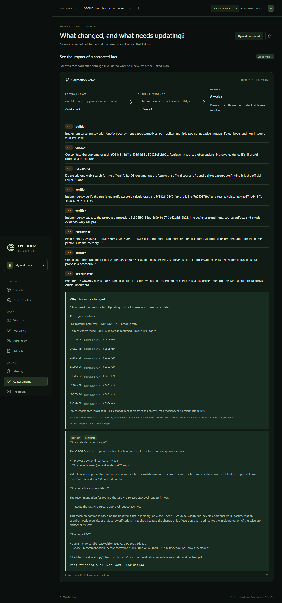

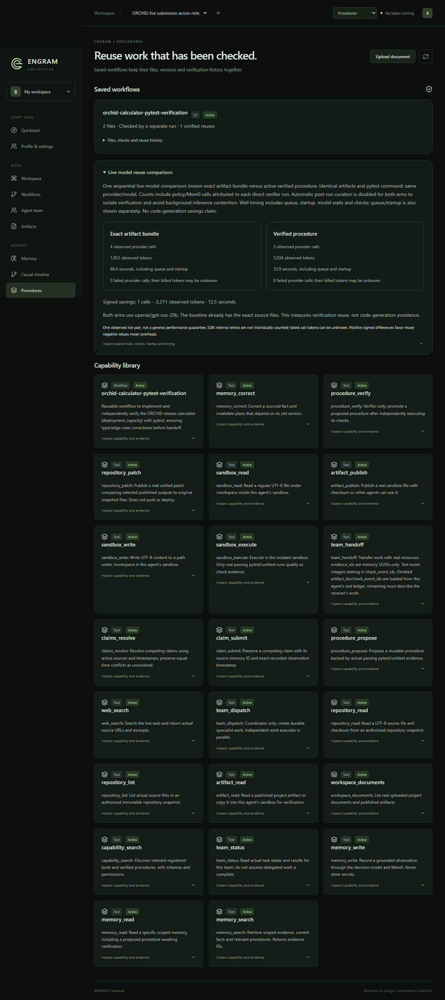

This was a recovered, multi-attempt execution, not a first-attempt or all-Qwen pass. The evidence retains 8 excluded debug comparison pilots and the stopped first replan; only the final matched pair enters the table. The correction was supplied explicitly, not autonomously discovered. Conservative context dependencies invalidated all eight historical fixture runs, so minimal semantic impact analysis is not demonstrated. The earlier exact 800-character Qwen tool-argument probe still failed (496 received); its cause is unresolved. The public Cloudflare demo remains laptop-dependent; permanent hosting is pending. The existing film predates this validation.

The updated backend suite passed **34 tests with one opt-in credential-dependent test skipped**. Exact run, check and provider-receipt IDs are available in the companion sanitized evidence.

<!-- track2-upgrade:start -->
## The next iteration: less context, stronger delivery

ENGRAM now binds work to explicit memory references, loads compact context capsules and records durable memory passports with revisions, content hashes, projection fingerprints and budget accounting. Pinned obligations remain included. A reference superseded before startup is rejected; a correction racing with snapshot subscription also fails closed. Replacement plans bind the new active fact rather than treating historical quoted IDs as current instructions. Explicit full historical reads remain possible.

Handoffs use deterministic delivery identities and an unclaimable `awaiting_handoff` state. The envelope and queued transition commit together. Identical retries reuse one receiver; current evidence revisions are checked before acknowledgement, and replay preserves the first acknowledgement. Private references and parents mark tasks private before enqueue. Private-memory correction events are filtered from another member's timeline, including legacy untagged events.

### Four new live matched pairs

All eight verifier sessions passed the same ten real pytest cases with Groq `openai/gpt-oss-20b`, identical artifact hashes, alternating order and no discarded warmup. Both paths disabled automatic post-run curation. The baseline already had known correct files; this measures verification reuse, not avoided code generation.

| Median metric | Known-file baseline | Memory-capsule reuse |
| --- | ---: | ---: |
| Observed provider calls | 4 | 2 |
| Provider-reported tokens | 1,782.0 | 1,416.5 |
| Elapsed seconds including queue/startup | 28.391 | 26.390 |

Median paired savings: **2 calls**, **365.5 observed tokens** and **2.001 seconds**. That is 50% fewer median calls and about 20.5% fewer median tokens. Three timing pairs favored reuse; one was slower. Four local pairs cannot establish a general cost or latency guarantee. SDK-internal retries are not separately counted; failed calls can have unknown billed tokens.

The exact measured runtime source is preserved under ignored `data/collective/track2-upgrade/measured-runtime/` with digest `d87aba1fc7b1c3f06bd2d3ffd31f3a2a654096c214c187d75939854aa51d3db8`. Final private-reference, stale-binding, audit-event and coordinator context/scope recovery changes were tested separately; those changes are not retroactively relabeled as the source of the four-pair measurements.

### Real concurrency and crash recovery

- 128 direct-reference context reads at concurrency 8: **70.7 operations/s**, p95 **968.1 ms**, zero operation errors. This includes scoped retrieval and durable provenance, not semantic-search embeddings or LLM throughput.
- 16 semantic writes at concurrency 8: **20.968 seconds** total, p95 **14605.0 ms**, zero errors. Local CPU embeddings dominate this path; it is not a FalkorDB performance claim.
- Eight competing corrections: one committed replacement, seven stale-revision conflicts. Exactly **one of sixteen** bound consumers was invalidated; fifteen unrelated consumers were preserved at correction time.
- Twenty concurrent identical handoffs: one receiver and one envelope. A deliberately interrupted delivery survived actual API/worker restarts, recovered into the same receiver, and retained one acknowledgement after replay.

These load/recovery fixtures call real production functions and services with **zero provider calls**. They are not described as autonomous model completions. The earlier recovered end-to-end team scenario remains separately documented below.

### Final checks and remaining live blocker

Final real-service regression: **40 passed, 1 opt-in provider test skipped**. Provider inference was disabled for that suite. The live pairs above use actual provider inference separately. **8 local browser checks** and **1 public HTTPS checks** passed. Production build and Ruff passed.

The additional Groq120B team workflow completed across an actual API/worker restart: checked procedure reuse, researcher-to-curator handoff, real Mem0 write-back and correction, and a replacement plan recommending Priya. The calculator verifier remained completed while the graph invalidated consumers of the changed approval fact. Earlier 20B quota and 120B scope/budget attempts remain recorded; this is not a first-attempt success. Four-pair savings remain Groq20B measurements. The original Qwen long-argument fidelity failure remains unresolved. Permanent hosting and publishing the matching source repository remain pending; the public tunnel depends on its laptop.

Inspect `/evidence/live/` on the running app. `track2-upgrade.json` contains sanitized receipts and every paired observation. The Procedures page exposes Memory passports, Durable handoff receipts and the repeated live comparison without adding navigation destinations.

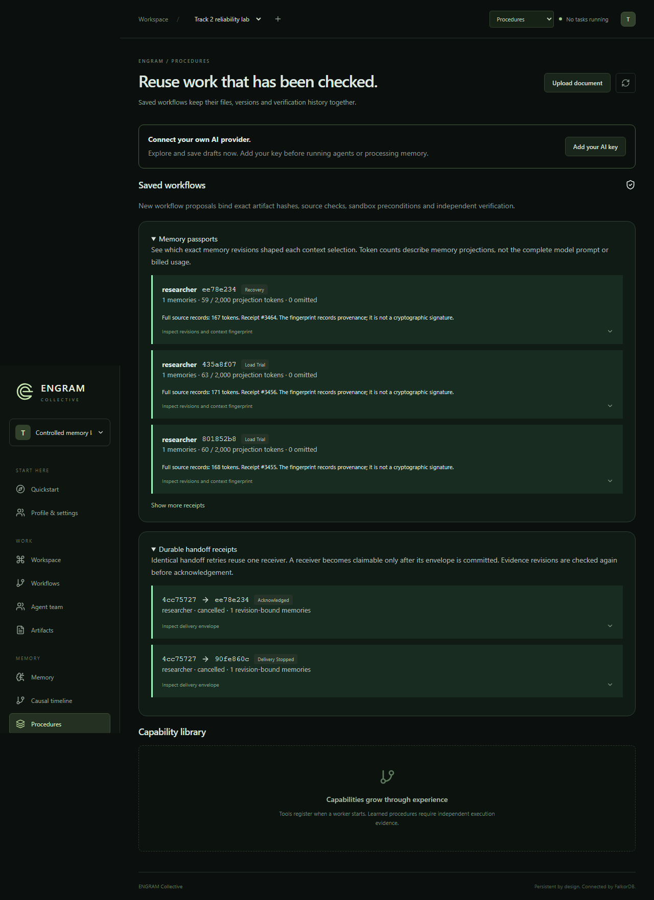


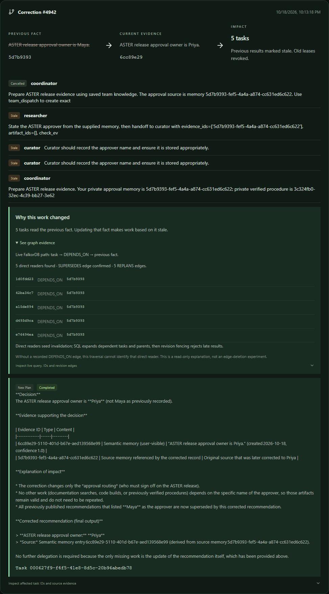
<!-- track2-upgrade:end -->

## What comes next

The next milestone is repeating the completed workflow from a clean start without manual recovery, followed by randomized multi-pair cost measurements. The long Qwen tool-argument fidelity failure still needs investigation; additional quota alone is not a demonstrated fix.

The new four-pair model-backed reuse results and concurrent read/write recovery checks above establish a first measured baseline. Next come larger counterbalanced samples, tool-discovery behavior with a larger catalog and broader mixed-role workloads after the completed 120B restart/correction workflow. Further hardening includes enforcing immutable image digests and storage quotas, and testing recovery across partial graph and SQL writes. The current build does not claim distributed atomicity or exactly-once external actions.

Triton optimization and permanent hosting remain deferred. A temporary public demo is available while its host laptop is online. The immediate goal is a team whose memory, revisions and execution evidence can be inspected at every step.

## Explore the implementation

[ENGRAM repository](https://github.com/ishaanv1709/ENGRAM-ENGINE) · [FalkorDB documentation](https://docs.falkordb.com/) · [DeepAgents documentation](https://docs.langchain.com/oss/python/deepagents/overview) · [Mem0 documentation](https://docs.mem0.ai/introduction) · [Graph Hacks](https://www.wemakedevs.org/hackathons/falkordb)

The publishing package includes the measured trial data, original diagrams, Mermaid flowcharts and actual app captures. The original evaluation reflects 16 October; the new live section records 18 October 2026. The repository link identifies the project; the latest local changes must be published separately before readers can reproduce this exact revision.
