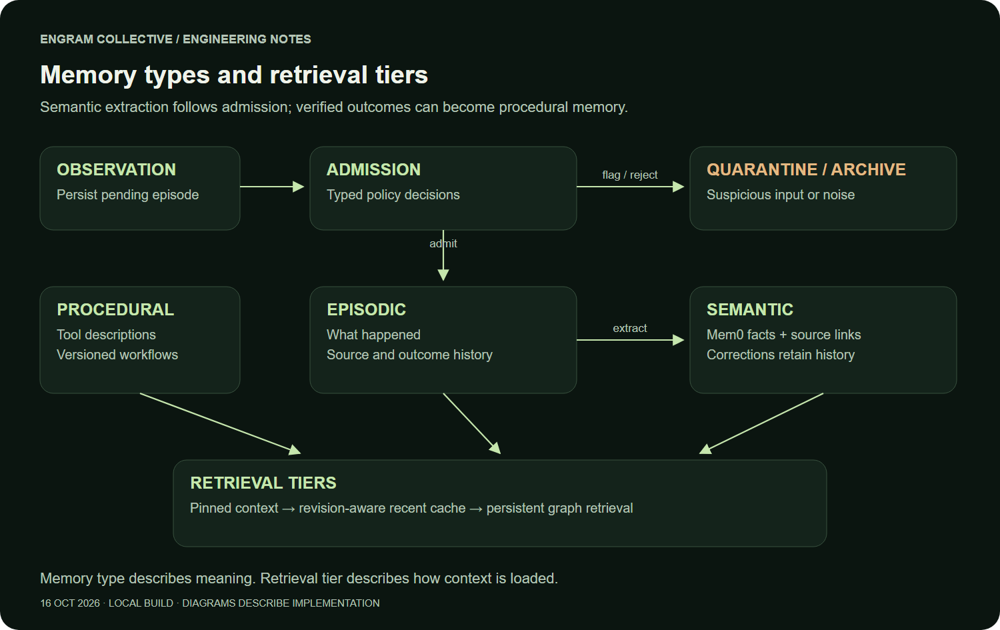

# The Best Agent Team Remembers Why

## ENGRAM ENGINE: persistent memory and coordination for Graph Hacks Track 2

A release plan looks reasonable. The tests pass. A researcher has checked the approval process, and the team has saved its findings. Then someone corrects one fact: Priya owns the release approval, not Maya.

What should the agents do next?

Starting everything again wastes the work that is still valid. Continuing with the old plan carries a known mistake forward. Asking a language model to reread a transcript leaves the decision dependent on whatever fits into its next prompt.

ENGRAM ENGINE takes a more inspectable route. It records which knowledge a task used, follows those relationships when that knowledge changes, and creates a new plan with current evidence. The calculator verifier keeps its completed result because the approval owner did not affect its work.

That is the project in one sentence: **ENGRAM ENGINE is a team of AI agents that shares persistent graph memory, coordinates work, and traces how changing knowledge affects its decisions.**

[Explore the project](https://engram-collective.spring-cherry-c778.workers.dev/) · [Read the live evidence](https://engram-collective.spring-cherry-c778.workers.dev/evidence/live/) · [Browse the source](https://github.com/ishaanv1709/ENGRAM-ENGINE)

*The architecture connects agent execution to durable records and explicit memory relationships. Each store has a distinct job.*

## A team with a memory contract

The execution layer uses LangChain DeepAgents. A coordinator delegates work to specialists, and specialists can hand work to other agents. Research, independent verification, and memory curation can progress as separate tasks instead of becoming one long conversation.

The interesting part is what travels between them. A handoff includes a recorded packet and explicit memory references. The receiving agent gets a bounded context capsule, subject to the same visibility rules as an ordinary memory read. The system records what was delivered and acknowledged.

Persistent state also gives a restart a concrete meaning. A task has an identity before delivery, its handoff can be recovered, and its checkpoints survive the process that produced them. Recovery still needs idempotency and careful boundaries. A durable receipt is not a promise that every external action happens exactly once.

## Three kinds of memory, three ways to retrieve it

Memory type and retrieval tier answer different questions.

**Episodic memory** records what happened: conversations, observations, task outcomes, and their sources. **Semantic memory** captures facts extracted and updated through Mem0, with source links and revision history. **Procedural memory** describes tools and reusable workflows, including the versions and checks needed to use them responsibly.

Retrieval tiers determine how that information reaches an agent. Pinned context preserves essential references. A revision-aware recent cache handles frequently used material. Persistent retrieval reaches the graph and memory stores for information outside that immediate context.

These ideas work together. A procedural memory can be retrieved semantically, then loaded with exact artifact references. A corrected semantic fact can invalidate a previously prepared capsule. Episodic evidence remains available even after its extracted fact has been superseded.

*Memory type describes meaning. Retrieval tier describes how context is loaded.*

The Memory Manager coordinates these reads and writes. PostgreSQL persists application records and checkpoints. FalkorDB holds connected memory and task relationships. Qdrant supports vector retrieval. Mem0 handles structured fact extraction and updates. None of those components makes the others redundant.

## The demo: change one fact, change the right action

The main demonstration follows a release workflow with a deliberately narrow correction.

1. A coordinator starts with source material identifying Maya as the approval owner.
2. A researcher and an independent calculator verifier run as separate specialists. Their running states overlap. Additional curation handoffs produce a team of five completed agents.
3. The verifier executes ten real pytest cases. The team completes two sourced Mem0 write-backs and two acknowledged handoffs.
4. The API and worker restart. Conversation history, artifact hashes, and 24 coordinator checkpoint rows remain intact.
5. New source material corrects the approval owner to Priya. The memory pipeline admits the correction and preserves the old fact as superseded history.
6. The system identifies affected work and finishes a replacement plan using Priya. The unrelated calculator verifier remains completed.

*The live workflow shows a corrected approval owner, affected work, and a replacement plan. The unrelated verifier keeps its result.*

The graph matters at step six. `DEPENDS_ON` records the evidence a task relied on. `SUPERSEDES` preserves the relationship between a correction and the knowledge it replaces. `REPLANS` connects replacement work to earlier work. The impact calculation uses these recorded relationships together with task descendants expanded from SQL.

This is a practical boundary: the demonstration does not claim that a graph algorithm alone schedules the entire team. It shows that recorded relationships change the work the system considers stale and the evidence used by the next plan.

The successful five-agent trial used Groq's `openai/gpt-oss-120b`. Earlier quota failures and unsuccessful attempts remain in the evidence history. The final result is a recovered, verified workflow, not a claim that every attempt succeeded immediately.

## A procedure is more than a saved prompt

A reusable workflow should say what it applies to and how it was checked.

ENGRAM ENGINE stores a procedure with a version, bound artifact hashes, preconditions, and independent verification evidence. Reuse prepares those exact artifacts and runs fresh checks. A changed artifact cannot silently inherit the verification result of an older version.

Tool descriptions are also treated as retrievable procedural knowledge. The agent can discover relevant capabilities instead of receiving an ever-growing catalog in every prompt. Workflow reuse goes further by carrying a tested path through those capabilities.

*Verification belongs to a particular artifact version. Reuse still produces a new check receipt.*

Passing ten calculator tests establishes those assertions for those bytes. It does not prove arbitrary generated code is correct. Keeping that distinction visible makes procedural memory more useful than simply marking a past answer as successful.

## Did reuse actually save anything?

We ran four matched baseline/reuse pairs, alternating their order. All eight sessions used Groq's `openai/gpt-oss-20b`, the same two artifact hashes, and the same ten pytest cases. These are separate from the 120B team demonstration.

| Metric | Baseline median | Reuse median |
| --- | ---: | ---: |
| Model calls | 4 | 2 |
| Recorded tokens | 1,782 | 1,416.5 |
| Elapsed time | 28.391 seconds | 26.390 seconds |

For this workload, the medians show **50% fewer model calls** and **about 20.5% fewer recorded tokens**. The median paired time saving was about two seconds. Three pairs were faster with reuse; one was slower.

*Measured results for one small, controlled workload. Individual trials and their limits are published alongside the summary.*

This is evidence of reduced model work for this task, not a general speed guarantee. The baseline already had correct code. The comparison measures using a verified procedure instead of asking an agent to rediscover the workflow, rather than comparing code generation against copying a solution. Earlier exploratory runs and negative results remain separate from the matched series.

## Shared memory under contention

Coordination becomes harder when agents write simultaneously. A second verification layer exercises the real database and graph functions without spending provider calls.

The concurrency fixtures performed 128 context reads and 16 semantic writes with concurrency eight. Eight competing corrections against the same revision produced one committed correction and seven HTTP 409 conflicts. Twenty parallel deliveries of the same handoff produced one receiving task and one packet. A staged handoff recovered across a real process restart with its identity and acknowledgement preserved.

These are infrastructure fixtures, not 128 model-driven agents. They test specific race and recovery boundaries. Competing claims are preserved with sources and timestamps, while stale revision checks prevent a losing correction from overwriting the accepted state silently.

Tenant and owner visibility apply during retrieval and handoff. Sharing team state does not grant unrestricted access to every user's private memories. Context receipts record references and revisions so that a later correction can be checked against what an agent actually received.

## Security boundaries worth spelling out

Agent-generated code runs inside restricted Docker sandboxes. The execution path applies limits and disables network access for untrusted child containers. Admission checks use a dedicated Safeguard model to judge proposed memory input before it becomes active knowledge.

Those are useful controls with different responsibilities. A model judgment is probabilistic, so it is not proof that an input is harmless. Container restrictions constrain execution, but they do not make arbitrary code universally safe. Source tracking, visibility checks, independent verification, and bounded execution each cover a different part of the workflow.

The current verification record includes 40 passing backend tests, eight local browser tests, and one public HTTPS browser test. One optional provider-inference pytest test was skipped. The actual provider-driven team workflow and the eight reuse sessions are reported separately.

## What you can inspect today

The public Cloudflare website contains the quickstart and evidence pages. The full backend migration is still in progress: agent execution currently depends on the running development machine. Public frontend hosting should not be mistaken for an already independent cloud agent runtime.

The evidence is designed to make that distinction easy to check. It contains the restart result, correction trail, procedure measurements, concurrency fixtures, and limitations. Source code is available for readers who want to follow a receipt back to its implementation.

For Track 2, the strongest moment is small and visible: an approval owner changes, the affected plan changes with it, and an unrelated verified result survives. That is the behavior I want from a persistent agent team. It should remember enough to continue, and enough to know when continuing would be wrong.

**Try it:** [ENGRAM ENGINE](https://engram-collective.spring-cherry-c778.workers.dev/)  
**Inspect it:** [Live evidence and measurements](https://engram-collective.spring-cherry-c778.workers.dev/evidence/live/)  
**Read it:** [Source repository](https://github.com/ishaanv1709/ENGRAM-ENGINE)
